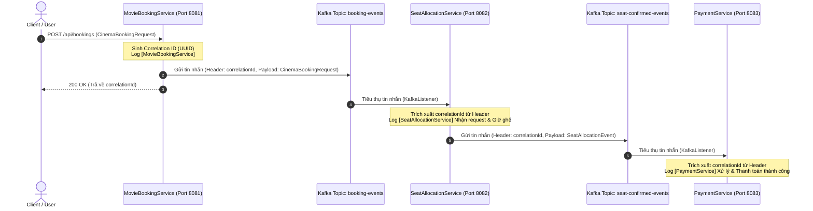

# BÀI TẬP 2: XÂY DỰNG "BẢN ĐỒ DẪN ĐƯỜNG" VỚI CORRELATION ID & TRACING

Hệ thống đặt vé xem phim trực tuyến phân tán áp dụng mô hình **Choreography Saga** giao tiếp qua **Apache Kafka**, sử dụng **Correlation ID** truyền qua **Kafka Message Header** để truy vết (distributed tracing) toàn bộ vòng đời giao dịch.

---

## 1. Kiến trúc & Mô tả luồng sự kiện (Event Flow)

### 1.1. Luồng xử lý phân tán (Choreography Saga)



### 1.2. Vai trò của Correlation ID trong hệ thống phân tán

1. **Định danh duy nhất giao dịch phân tán**: Trong kiến trúc Microservices và Event-Driven Architecture (EDA), một giao dịch nghiệp vụ (ví dụ: đặt vé) sẽ trải qua nhiều service khác nhau một cách bất đồng bộ. Correlation ID hoạt động như một "sợi chỉ đỏ" xâu chuỗi mọi log và sự kiện của giao dịch đó.
2. **Ngăn chặn hiện tượng "Event Spaghetti" (Mất dấu luồng)**: Khi hàng ngàn giao dịch diễn ra đồng thời, các log xen kẽ nhau. Nhờ có Correlation ID, ta có thể lọc (filter) toàn bộ log của một giao dịch từ đầu đến cuối trên ELK Stack, Grafana Loki, hoặc OpenTelemetry/Jaeger.
3. **Phục vụ Distributed Tracing & Debugging**: Hỗ trợ đội ngũ vận hành và lập trình viên nhanh chóng xác định điểm lỗi, nghẽn mạng (bottleneck) hoặc thất bại ở service nào để kích hoạt bù trừ (Compensating Transaction) kịp thời.

---

## 2. Kỹ thuật gắn Correlation ID vào Header và Lợi ích

### 2.1. Cách thức triển khai

- **Phía Producer (Gửi tin nhắn)**: Gắn Correlation ID trực tiếp vào `ProducerRecord.headers()` dưới dạng byte array (`StandardCharsets.UTF_8`):
  ```java
  ProducerRecord<String, String> record = new ProducerRecord<>("booking-events", bookingId, payload);
  record.headers().add("correlationId", correlationId.getBytes(StandardCharsets.UTF_8));
  kafkaTemplate.send(record);
  ```
- **Phía Consumer (Nhận tin nhắn)**: Đọc Correlation ID từ `ConsumerRecord.headers()` mà không cần can thiệp vào payload:
  ```java
  Header header = record.headers().lastHeader("correlationId");
  String correlationId = (header != null) ? new String(header.value(), StandardCharsets.UTF_8) : "UNKNOWN";
  ```

### 2.2. Lợi ích so với việc đặt trong Payload

| Tiêu chí | Đặt Correlation ID trong Kafka Header (Khuyến nghị) | Đặt Correlation ID trong Payload DTO |
| :--- | :--- | :--- |
| **Tính độc lập của DTO (Clean Architecture)** | Tách biệt hoàn toàn metadata hạ tầng/tracing khỏi domain model nghiệp vụ. | Làm "bẩn" DTO nghiệp vụ, model nào cũng phải thêm trường `correlationId`. |
| **Khả năng tái sử dụng (Reusability)** | DTO nghiệp vụ có thể tái sử dụng cho REST API, gRPC mà không cần trường phụ thuộc Kafka. | Các service khác dùng chung DTO bắt buộc phải phụ thuộc schema đó. |
| **Xử lý trung gian (Interceptors/Gateway/Middleware)** | Các API Gateway, Kafka Interceptors, Tracing Filter có thể đọc/ghi Correlation ID trực tiếp mà không cần parse/deserialize JSON payload (tiết kiệm CPU). | Phải deserialize toàn bộ JSON payload chỉ để đọc correlationId. |
| **Tiêu chuẩn công nghiệp** | Phù hợp tiêu chuẩn OpenTelemetry, W3C TraceContext, B3 Propagation. | Không chuẩn hóa, phụ thuộc vào từng nhóm phát triển. |

---

## 3. Cấu trúc thư mục dự án

```
SS15_HW02_NguyenDinhSon_PTIT_HN_053/
├── docker-compose.yml                      # Khởi chạy Apache Kafka & Zookeeper
├── build.gradle                            # Cấu hình Gradle Root đa module
├── settings.gradle                         # Khai báo các module con
├── README.md                               # Báo cáo phân tích và hướng dẫn
│
├── movie-booking-service/                  # Producer khởi tạo giao dịch (Port: 8081)
│   ├── build.gradle
│   └── src/
│       ├── main/java/com/example/movie/
│       │   ├── MovieBookingApplication.java
│       │   ├── controller/
│       │   │   └── MovieBookingController.java
│       │   ├── service/
│       │   │   └── BookingPublisherService.java
│       │   └── model/
│       │       └── CinemaBookingRequest.java
│       ├── main/resources/
│       │   └── application.yml
│       └── test/java/com/example/movie/
│           └── BookingPublisherServiceTest.java
│
├── seat-allocation-service/                 # Consumer giữ ghế & Producer xác nhận (Port: 8082)
│   ├── build.gradle
│   └── src/
│       ├── main/java/com/example/seat/
│       │   ├── SeatAllocationApplication.java
│       │   ├── consumer/
│       │   │   └── BookingEventConsumer.java
│       │   ├── producer/
│       │   │   └── SeatConfirmedProducer.java
│       │   ├── service/
│       │   │   └── SeatAllocationService.java
│       │   └── model/
│       │       ├── CinemaBookingRequest.java
│       │       └── SeatAllocationEvent.java
│       ├── main/resources/
│       │   └── application.yml
│       └── test/java/com/example/seat/
│           └── SeatAllocationConsumerProducerTest.java
│
└── payment-service/                         # Consumer thanh toán (Port: 8083)
    ├── build.gradle
    └── src/
        ├── main/java/com/example/payment/
        │   ├── PaymentApplication.java
        │   ├── consumer/
        │   │   └── SeatConfirmedConsumer.java
        │   ├── service/
        │   │   └── PaymentProcessingService.java
        │   └── model/
        │       ├── PaymentEvent.java
        │       └── SeatAllocationEvent.java
        ├── main/resources/
        │   └── application.yml
        └── test/java/com/example/payment/
            └── PaymentConsumerTest.java
```

---

## 4. Hướng dẫn cài đặt và chạy chương trình

### 4.1. Yêu cầu môi trường
- Java Development Kit (JDK) 17 trở lên (đã kiểm thử tương thích JDK 21 / 25).
- Docker & Docker Compose (dùng để chạy Kafka Broker).
- Gradle (hoặc dùng `./gradlew` đi kèm).

### 4.2. Bước 1: Khởi động Apache Kafka & Zookeeper
Tại thư mục gốc của dự án, mở Terminal và chạy lệnh:
```bash
docker compose up -d
```
> Kiểm tra Kafka đã sẵn sàng tại địa chỉ `localhost:9092`.

### 4.3. Bước 2: Chạy đồng thời 3 Microservices

Mở 3 cửa sổ Terminal riêng biệt và chạy từng service:

- **Terminal 1: Chạy MovieBookingService (Port 8081)**
  ```bash
  ./gradlew :movie-booking-service:bootRun
  ```

- **Terminal 2: Chạy SeatAllocationService (Port 8082)**
  ```bash
  ./gradlew :seat-allocation-service:bootRun
  ```

- **Terminal 3: Chạy PaymentService (Port 8083)**
  ```bash
  ./gradlew :payment-service:bootRun
  ```

*(Hoặc trên Windows PowerShell: `.\gradlew.bat :movie-booking-service:bootRun`, `.\gradlew.bat :seat-allocation-service:bootRun`, `.\gradlew.bat :payment-service:bootRun`)*

---

## 5. Hướng dẫn kiểm thử (Testing) & Kết quả mong muốn

### 5.1. Chạy Unit & Integration Test tự động
Dự án đã tích hợp đầy đủ Mockito Unit Tests cho cả 3 service kiểm tra việc sinh, gắn và trích xuất Correlation ID từ Header:
```bash
./gradlew test
```

### 5.2. Gửi yêu cầu đặt vé mẫu (Sample Request)

Dùng cURL hoặc Postman gửi request `POST` đến `http://localhost:8081/api/bookings`:

```bash
curl -X POST http://localhost:8081/api/bookings \
  -H "Content-Type: application/json" \
  -d '{
    "cinemaBookingId": "CIN-2024-789",
    "movieCode": "AVENGERS-5",
    "showTime": "2024-12-25T19:30:00",
    "seatNumbers": ["A12", "A13"],
    "customerEmail": "tuananh@email.com",
    "totalPrice": 240000
  }'
```

**Response từ MovieBookingService:**
```json
{
  "status": "SUCCESS",
  "message": "Yêu cầu đặt vé đã được tiếp nhận và xử lý theo luồng Saga",
  "cinemaBookingId": "CIN-2024-789",
  "correlationId": "550e8400-e29b-41d4-a716-446655440000"
}
```

### 5.3. Kết quả Log thực tế thu được xuyên suốt 3 Service

Khi đối chiếu log giữa 3 service, giá trị **CorrelationID** là duy nhất và hoàn toàn đồng nhất:

```text
[MovieBookingService] Created booking CIN-2024-789. CorrelationID: 550e8400-e29b-41d4-a716-446655440000
[SeatAllocationService] Received SeatRequest for CIN-2024-789. CorrelationID: 550e8400-e29b-41d4-a716-446655440000
[SeatAllocationService] Seat reserved: A12, A13. CorrelationID: 550e8400-e29b-41d4-a716-446655440000
[PaymentService] Processing Payment for CIN-2024-789. CorrelationID: 550e8400-e29b-41d4-a716-446655440000
[PaymentService] Payment success: 240000 VND. CorrelationID: 550e8400-e29b-41d4-a716-446655440000
```
